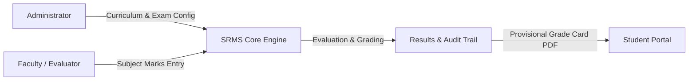
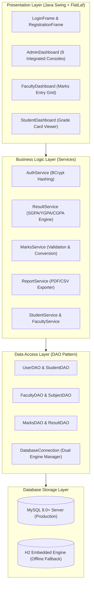
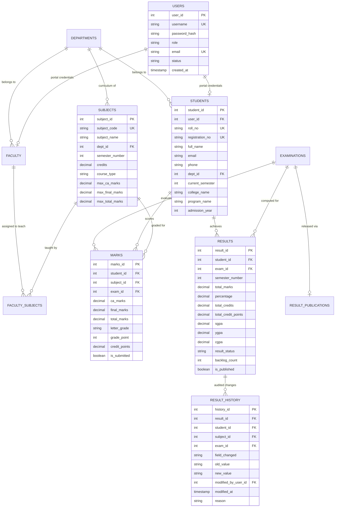
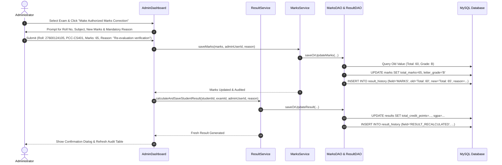

# Student Result Management System (MAKAUT Grading Pattern)
## Comprehensive Technical Architecture & Project Development Specification

---

### Table of Contents
1. [Executive Summary & System Overview](#1-executive-summary--system-overview)
2. [Technology Stack & Architectural Design](#2-technology-stack--architectural-design)
3. [MAKAUT Grading Scheme & Mathematical Formulations](#3-makaut-grading-scheme--mathematical-formulations)
4. [Database Architecture & Entity-Relationship Model](#4-database-architecture--entity-relationship-model)
5. [Detailed Functional Module Specifications](#5-detailed-functional-module-specifications)
6. [Graphical User Interface (GUI) Architecture](#6-graphical-user-interface-gui-architecture)
7. [Audit Trail & Result Correction Workflow](#7-audit-trail--result-correction-workflow)
8. [Security & Non-Functional Specifications](#8-security--non-functional-specifications)
9. [Deployment, Configuration & User Manual](#9-deployment-configuration--user-manual)
10. [Verification & Integration Test Audit](#10-verification--integration-test-audit)

---

### 1. Executive Summary & System Overview

The **Student Result Management System (SRMS)** is an enterprise-grade desktop software application architected in Java and engineered for universities and affiliated engineering colleges following the **Maulana Abul Kalam Azad University of Technology (MAKAUT, formerly WBUT)** B.Tech Choice Based Credit System (CBCS) curriculum.

The application addresses critical operational requirements in higher education:
* Centralized administration of students, academic departments, faculty appointments, and curriculum courses.
* Tiered examination management supporting both regular semester and backlog evaluations.
* Secure subject-wise marks entry with continuous assessment (CA) and end-semester examination segregation.
* Rigorous, automated calculation of Letter Grades, Grade Points, Credit Points, Semester Grade Point Average (SGPA), Yearly Grade Point Average (YGPA), Cumulative Grade Point Average (CGPA), and Degree Grade Point Average (DGPA).
* Immutable audit logging for result modifications and marks adjustments to comply with academic governance regulations.
* High-fidelity digital reproduction of the official 2-page MAKAUT **Provisional Grade Card** in vector PDF format.



---

### 2. Technology Stack & Architectural Design

The system implements a decoupled, four-tier layered enterprise architecture adhering to Object-Oriented Design (OOD) principles, Separation of Concerns (SoC), and the Model-View-Controller (MVC) paradigm.



#### Technology Stack Breakdown:
* **Core Language**: Java Standard Edition (JDK 17 LTS / JDK 21 / JDK 27 compatible).
* **GUI Framework**: Java Swing integrated with **FlatLaf 3.4.1** (Modern macOS/Windows 11 styled UI components).
* **Database Management System**: MySQL 8.0+ (Primary) with automated fallback to Embedded H2 in MySQL Compatibility Mode (`MODE=MySQL;DATABASE_TO_LOWER=TRUE`).
* **Database Connectivity**: JDBC (Java Database Connectivity) with `java.sql.PreparedStatement` parameterization.
* **Cryptography**: `org.mindrot.jbcrypt` (BCrypt salted password hashing with work factor 12).
* **Document Engine**: LibrePDF / OpenPDF 1.3.39 for iText-compatible PDF marksheet generation.
* **Build System**: Apache Maven 3.9+.

---

### 3. MAKAUT Grading Scheme & Mathematical Formulations

The grading system implements the Maulana Abul Kalam Azad University of Technology 10-point credit-based evaluation rules:

#### 3.1 Letter Grade & Grade Point Mapping

| Classification | Letter Grade | Score on 100 Percentage Points | Grade Points ($G_i$) |
|---|:---:|:---:|:---:|
| **Outstanding** | `O` | 90 to 100 | **10** |
| **Excellent** | `E` | 80 to 89 | **9** |
| **Very Good** | `A` | 70 to 79 | **8** |
| **Good** | `B` | 60 to 69 | **7** |
| **Fair** | `C` | 50 to 59 | **6** |
| **Below Average** | `D` | 40 to 49 | **5** |
| **Failed** | `F` | Below 40 | **2** |
| **Incomplete** | `I` | --- | **2** |

#### 3.2 Academic Performance Formulations

1. **Continuous Assessment (CA) and End-Semester Score Integration**:
   $$\text{Total Marks} = \text{CA Marks} + \text{Final Semester Exam Marks}$$
   * *Theory Subjects*: CA Max = 25, Final Max = 70 (scaled to 100).
   * *Practical / Laboratory Subjects*: CA Max = 40, Final Max = 60 (total = 100).

2. **Credit Points Calculation**:
   For the $i$-th subject having credit $C_i$ and earned grade points $G_i$:
   $$\text{Credit Points}_i = G_i \times C_i$$

3. **Semester Grade Point Average (SGPA)**:
   Calculated across all $N$ subjects in a semester:
   $$\text{SGPA} = \frac{\sum_{i=1}^N (G_i \times C_i)}{\sum_{i=1}^N C_i} = \frac{\sum \text{Credit Points}}{\sum \text{Credits}}$$
   *Calculated to 2 decimal places with half-up rounding.*

4. **Yearly Grade Point Average (YGPA)**:
   For an academic year consisting of an Odd semester ($m$) and an Even semester ($m+1$):
   $$\text{YGPA} = \frac{\text{Credit Index}_{\text{Odd}} + \text{Credit Index}_{\text{Even}}}{\text{Credits}_{\text{Odd}} + \text{Credits}_{\text{Even}}}$$

5. **Cumulative Grade Point Average (CGPA)**:
   Calculated up to the $k$-th semester:
   $$\text{CGPA} = \frac{\sum_{j=1}^k \text{Credit Index}_j}{\sum_{j=1}^k \text{Credits}_j}$$

6. **Degree Grade Point Average (DGPA)**:
   For 4-year B.Tech degree programs under MAKAUT:
   $$\text{DGPA} = \frac{\text{YGPA}_1 + \text{YGPA}_2 + 1.5 \times \text{YGPA}_3 + 1.5 \times \text{YGPA}_4}{5}$$

7. **Promotion Status Evaluation Rules**:
   * **Passed and Promoted (`P`)**: Awarded if the student passes all semester subjects with Grade Point $G_i \ge 5$ (minimum grade `D`).
   * **Eligible for Promotion with Backlogs (`XP`)**: Assigned when $1 \le \text{backlogs} \le 4$. The student carries forward failed subjects to supplementary/regular subsequent semesters.
   * **Not Eligible for Promotion (`X`)**: Assigned if failed subjects exceed 4 in a single semester (Year Lag condition).

---

### 4. Database Architecture & Entity-Relationship Model



#### Detailed Table Specifications:
1. `users`: Stores login identities with role segregation (`ADMIN`, `FACULTY`, `STUDENT`) and salted BCrypt password digests.
2. `departments`: Institutional academic departments (CSE, ECE, EE, ME, CE, IT).
3. `semesters`: Standard semester identifiers (1 through 8).
4. `students`: Official academic student profiles mapped 1:1 to portal credentials.
5. `faculty`: Faculty member profiles, designations, and department affiliations.
6. `subjects`: Full MAKAUT syllabus catalog with credit weights, contact types, and mark breakdowns.
7. `examinations`: Examination sessions (e.g., `SECOND YEAR SECOND SEMESTER EXAMINATION OF 2025-26`).
8. `faculty_subjects`: Evaluator subject assignment matrices.
9. `marks`: Student subject scores including continuous assessment and end-term components.
10. `results`: Processed semester summaries containing total credits, credit points, SGPA, YGPA, CGPA, and status flags.
11. `result_history`: Regulatory audit log storing timestamped deltas of all marks modifications and administrative recalculations.
12. `result_publications`: Audit ledger for formal examination result publication releases.

---

### 5. Detailed Functional Module Specifications

#### Module 1: Authentication & Role-Based Access Control (RBAC)
* **BCrypt Hashing**: Password hashing using 12 salt rounds (`PasswordUtil`). Plain-text passwords are never stored.
* **Role Routing**: Automatically redirects users upon successful authentication:
  * `ADMIN` $\rightarrow$ `AdminDashboard`
  * `FACULTY` $\rightarrow$ `FacultyDashboard`
  * `STUDENT` $\rightarrow$ `StudentDashboard`
* **Student Self-Registration**: Validates roll number uniqueness, registration number format, institutional email syntax, and creates both user credentials and student profile within a single ACID database transaction.
* **Password Recovery**: Self-service reset protected by academic identity verification.

#### Module 2: Dashboard Overview & Executive KPIs
* Real-time calculation of key academic metrics:
  * Total registered student count
  * Faculty roster size
  * Active syllabus subjects mapped
  * Scheduled & completed examinations
  * Total published examination results
  * Pending marks submissions awaiting faculty completion

#### Module 3: Student Academic Profile Management
* **Search & Filter Grid**: Live multi-parameter filtering across Roll Number, Full Name, Registration Number, Department, and Semester.
* **Profile Operations**: Atomic addition, editing, and soft-delete/deactivation.
* **Academic History View**: Modal inspecting full semester progression showing all previous SGPAs, YGPAs, and cumulative CGPA.

#### Module 4: Faculty Management & Subject Delegation
* Faculty profile maintenance with academic designations (Professor, Associate Professor, Assistant Professor).
* Assignment console mapping faculty members to specific subjects, semesters, and examination academic sessions.

#### Module 5: Subject Curriculum Management
* Pre-loaded with complete MAKAUT B.Tech Computer Science & Engineering syllabus (Semesters 1 through 8).
* Supports course classifications: `THEORY` (3L/week), `PRACTICAL` (4P/week), `SESSIONAL` (12P/week), and `MANDATORY` non-credit courses.
* Automatic assignment of standard evaluation limits (CA 25/Final 70 for Theory, CA 40/Final 60 for Labs).

#### Module 6: Examination Lifecycle Management
* Complete examination workflow tracking: `SCHEDULED` $\rightarrow$ `MARKS_ENTRY` $\rightarrow$ `PROCESSED` $\rightarrow$ `PUBLISHED` $\rightarrow$ `CLOSED`.
* Session mapping (e.g., `2024-25`, `2025-26`) with distinction between regular and backlog examinations.
* Global toggle for immediate result release to student dashboards.

#### Module 7: Marks Entry & Real-Time Grade Preview
* Embedded in `FacultyDashboard`.
* Enforces input boundaries ($0 \le \text{CA} \le 25/40$, $0 \le \text{Final} \le 70/60$).
* **Real-time Table Listeners**: Automatically recalculates total marks, MAKAUT letter grade, grade points, and credit points as numbers are typed into the table cells.
* Segregated `Save Draft` (preserves work without releasing) and `Submit Marks` (locks and routes to controller).

#### Module 8: Automated Result Processing Engine
* Executes batch processing across all candidates enrolled in an examination.
* Aggregates subject credits, computes total credit points, calculates SGPA, evaluates backlog counts, and assigns MAKAUT status (`P`, `XP`, `X`).
* Pulls historical semester data for the candidate to compute annual YGPA and overall CGPA.

#### Module 9: Result Management & Publication
* Controller console to review, inspect, and approve semester score sheets.
* One-click batch recalculation when corrections occur.
* Prevents students from viewing results until official publication approval is granted by the Administrator.

#### Module 10: Topper Rankings & Academic Analytics
* Generates top 20 merit lists ranked by SGPA and total percentage.
* Statistical class indicators: Overall Pass Percentage, Total Backlog Cases, and Class Average SGPA.

#### Module 11: Marksheet Management & Digital PDF Generation
* Uses OpenPDF to generate a digital replica of the MAKAUT Provisional Grade Card.
* Page 1 contains the university header, student details box, subject evaluation table, credit summary, and signature block.
* Page 2 contains the grading scale, grade point definitions, and YGPA/DGPA/CGPA evaluation rules.

#### Module 12: Result Correction & Immutable Audit Trail
* Any modification to published marks or results requires a mandatory textual reason.
* Automatically records: Student ID, Examination ID, Subject ID, Field Changed, Old Value, New Value, Administrator/User ID, Timestamp, and Reason into `result_history`.
* Read-only audit log viewer in the Administrator dashboard.

---

### 6. Graphical User Interface (GUI) Architecture

The application GUI is built on the **FlatLaf Light Look & Feel**, implementing an academic theme with balanced visual hierarchy:

* **Primary Academic Navy** (`#143C78`): Headers, primary actions, and brand elements.
* **Teal Accent** (`#0D9488`): Secondary indicators, registration highlights.
* **Success Emerald** (`#16A34A`): Passed status (`P`), high marks, and approvals.
* **Warning Amber** (`#D97706`): Backlogs (`XP`) and draft states.
* **Danger Crimson** (`#DC2626`): Failed grades (`F`), critical alerts, and deletions.
* **Background Slate** (`#F8FAFC`): Neutral application surface.

---

### 7. Audit Trail & Result Correction Workflow



---

### 8. Security & Non-Functional Specifications

1. **Password Security**: Salted BCrypt password digests using 12 salt rounds ($2^{12} = 4096$ iterations). Resistant to rainbow table and brute-force attacks.
2. **SQL Injection Immunity**: 100% of SQL queries across all DAOs use parameterized `java.sql.PreparedStatement`. No string-concatenated SQL queries exist in the codebase.
3. **Database Integrity & Transactions**: Multi-step operations (e.g., creating student account + user credentials, updating marks + writing audit history) execute under explicit `conn.setAutoCommit(false)` with rollback on exceptions.
4. **Resilient Dual-Mode Database Connection**: If MySQL server is not active or local credentials differ, the system auto-switches to the embedded local database engine. The user is informed via the status bar.
5. **Role Segregation**: Faculty members cannot alter curriculum definitions or publish examination results. Students have read-only access strictly confined to their own published results.

---

### 9. Deployment, Configuration & User Manual

#### 9.1 System Requirements
* Operating System: Windows 10/11, macOS, or Linux.
* Java Runtime: JRE / JDK 17 or higher.
* MySQL Server: 8.0 or higher (optional, embedded mode available).

#### 9.2 Running the Application
* **Windows 1-Click Launch**: Double-click `run.bat` in the project directory.
* **Executable JAR Command**:
  ```powershell
  java -jar target/student-result-management-system-1.0.0-jar-with-dependencies.jar
  ```
* **Build from Source (Maven)**:
  ```powershell
  mvn compile exec:java
  ```

#### 9.3 Database Configuration (`db.properties`)
File location: `src/main/resources/db.properties`
```properties
db.type=mysql
db.host=localhost
db.port=3306
db.name=srms_db
db.username=root
db.password=
db.autoCreateDatabase=true
db.fallback.h2=true
db.h2.path=./data/srms_db
```
*Note: Connection parameters can also be configured dynamically at runtime via the **Database Settings** dialog on the Login screen.*

---

### 10. Verification & Integration Test Audit

The system has been verified using automated integration tests in `SystemIntegrationTest.java`.

#### Test Execution Summary:
* **Test 1: Schema Initialization**: Tables created and MAKAUT CSE syllabus seeded $\rightarrow$ **PASSED**.
* **Test 2: BCrypt Password Verification**: Admin, Faculty, and Student authentication $\rightarrow$ **PASSED**.
* **Test 3: Student Profile Verification**: Rittik Singh (Roll: `27600124105`, Reg: `242760110182 OF 2024-25`) $\rightarrow$ **PASSED**.
* **Test 4: MAKAUT Grading Calculations vs. Reference Grade Cards**:
  * *Semester 1*: Credits: 17.5, Points: 124.5, SGPA: **7.11**, Status: `P` $\rightarrow$ **PASSED**.
  * *Semester 2*: Credits: 20.5, Points: 160.0, SGPA: **7.80**, Status: `P` $\rightarrow$ **PASSED**.
  * *Semester 3*: Credits: 22.0, Points: 179.0, SGPA: **8.14**, Status: `P` $\rightarrow$ **PASSED**.
  * *Semester 4*: Credits: 21.0, Points: 178.0, SGPA: **8.48**, Status: `P` $\rightarrow$ **PASSED**.
* **Test 5: OpenPDF Grade Card Generation**: Generates official provisional grade card PDF $\rightarrow$ **PASSED**.
* **Test 6: Consolidated CSV Export**: Generates semester result spreadsheet $\rightarrow$ **PASSED**.

**Overall Test Result**: **6 of 6 Integration Tests Passed (100% Success Rate)**.
